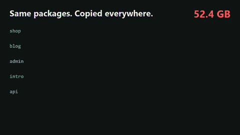
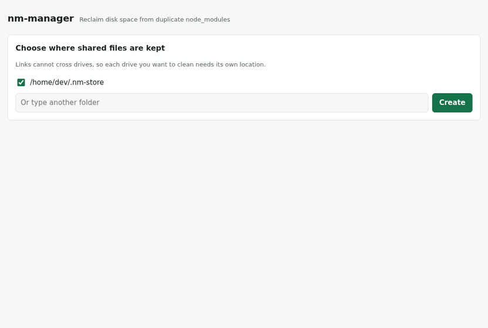

# nm-manager

**Reclaim disk space from duplicate `node_modules`, without migrating your projects to another package manager.**

[Türkçe](README.tr.md)



<sub>Illustration: the numbers are made up, and your savings depend on how much your projects overlap. The recording below is a real run.</sub>

Every project keeps its own copy of the same packages. pnpm prevents this for *new* installs, but moving existing projects means changing lockfiles and sometimes fixing broken imports. nm-manager works on what is already on your disk: it finds identical files across your projects and keeps each one only once. Your projects, lockfiles and package manager stay exactly as they are.


In this recording, seven real projects (Next.js, Vite, Remotion) drop by 483 MB out of 1.0 GB.

## Quick start

Requires Node.js 18.15 or newer. There are no dependencies.

```bash
npx nm-manager init
npx nm-manager scan ~/projects
npx nm-manager apply ~/projects
```

`scan` changes nothing. `apply` shows the list and asks which projects to include.

Prefer a window? `npx nm-manager ui` opens a local interface in your browser:



## Commands

| Command | What it does |
|---|---|
| `init [--store <path>]` | Chooses where shared files live. Each drive needs its own store. |
| `scan <dir>...` | Finds projects under the folders and estimates savings. Changes nothing. |
| `apply <dir>...` | Scans, asks, then shares identical files. `--yes` skips the question. |
| `undo <dir>...` | Gives projects independent copies again. |
| `gc [--dry-run]` | Deletes shared files that no project uses any more. |
| `status` | Shows stores and how much they save. |
| `verify [--fix]` | Checks that shared files are still intact. |
| `ui [--port <n>] [--no-open]` | Opens the web interface. |

## How it works

1. **Find.** It searches your folders for `node_modules`. It does not descend into one it has found, because nested `node_modules` belong to the same install.
2. **Compare.** Every file is identified by the SHA-256 of its content. Package names and versions play no part, so a patched file can never be mistaken for the original.
3. **Share.** The first copy of each file goes into a store. Every other copy is replaced atomically with a link to it. If the store already has a file, the project links straight to it, so later runs get cheaper.

Files are shared rather than whole packages, because Node resolves a symlink to its real location. A symlinked package would look for its dependencies in the store and fail. With file-level sharing, the folder structure stays identical and Node cannot tell the difference.

### Hard links and reflinks

| Filesystem | Method | If a shared file is edited |
|---|---|---|
| Btrfs and XFS (Linux) | Reflink (copy-on-write) | Only that project's copy changes |
| NTFS (Windows), ext4 (Linux), APFS (macOS) | Hard link | Every project sharing it changes |

The method is detected per volume by trying a reflink first, and `init` prints the result. Reflinks on APFS have not been confirmed yet, so expect hard links on macOS for now. Hard links are also used on Windows ReFS, because Node has no forced-clone call there.

## Safety

- **Atomic replacement.** A file is linked under a temporary name and renamed over the original, so an interruption leaves either the old file or the new one.
- **Content is checked.** A store file is re-hashed the first time each run uses it. One that was edited is quarantined and cannot spread to more projects.
- **Risky projects are skipped by default.** That covers projects using `patch-package` or similar tools, those in OneDrive, Dropbox, Google Drive or iCloud folders, and pnpm installs. `--include patched,synced` overrides the first two.
- **Caches are left alone.** `.cache`, `.vite`, `.next`, `.prisma` and similar folders, plus package-manager metadata, are never shared.
- **Files in use are skipped.** A locked file stays as it was and is listed in the report.
- **The interface is local.** It listens on `127.0.0.1` only and requires a secret token on every request.

Deleting a project or running `npm install` only removes that project's links. Run `gc` from time to time to free files nothing uses any more.

### What to watch out for on hard links

A tool that edits a file inside `node_modules` *in place* changes it for every project sharing it. Package managers replace files rather than editing them, so normal installs are fine. If this does happen, `verify` reports it, and reinstalling the affected projects fixes them.

## Limitations

- Links cannot cross drives, so each drive needs its own store.
- File managers such as Windows Explorer still show each folder at its full size. Check the drive's free space instead.
- Copying a project to another drive or into some backups produces full copies. This is safe, but those copies are not shared.
- Scanning reads every file, which downloads cloud-only files in a sync folder if you point it there.

## Development

```bash
npm test
```

The demos are recorded from real runs: see [scripts/demo/record.sh](scripts/demo/record.sh).

## License

MIT
