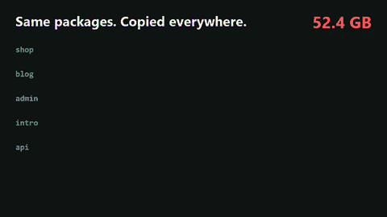
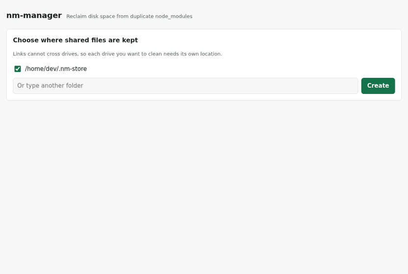

# nm-manager

**Kopya `node_modules` klasörlerinden disk alanı kazan, projelerini başka bir paket yöneticisine taşımadan.**

[English](README.md)



<sub>Temsilî animasyon: sayılar uydurmadır, kazancın projelerinin ne kadar örtüştüğüne bağlıdır. Aşağıdaki kayıt gerçek bir çalıştırmadır.</sub>

Her proje aynı paketlerin kendi kopyasını tutar. pnpm bunu *yeni* kurulumlarda önler, ama mevcut projeleri taşımak lock dosyalarını değiştirmek ve bazen bozulan import'ları düzeltmek demektir. nm-manager diskinde zaten olanla çalışır: projeler arasındaki birebir aynı dosyaları bulur ve her birini tek kopya olarak tutar. Projelerin, lock dosyaların ve paket yöneticin olduğu gibi kalır.


Bu kayıtta yedi gerçek proje (Next.js, Vite, Remotion) 1,0 GB içinden 483 MB kazandırıyor.

## Hızlı başlangıç

Node.js 18.15 veya üstü gerekir. Hiçbir bağımlılığı yoktur.

```bash
npx nm-manager init
npx nm-manager scan ~/projects
npx nm-manager apply ~/projects
```

`scan` hiçbir şeyi değiştirmez. `apply` listeyi gösterir ve hangi projelerin dahil edileceğini sorar.

Pencere mi tercih edersin? `npx nm-manager ui` tarayıcıda yerel bir arayüz açar:



## Komutlar

| Komut | Ne yapar |
|---|---|
| `init [--store <yol>]` | Ortak dosyaların duracağı yeri seçer. Her sürücüye ayrı depo gerekir. |
| `scan <klasör>...` | Klasörlerin altındaki projeleri bulur, kazancı tahmin eder. Hiçbir şeyi değiştirmez. |
| `apply <klasör>...` | Tarar, sorar, sonra aynı dosyaları ortaklaştırır. `--yes` soruyu atlar. |
| `undo <klasör>...` | Projelere yeniden bağımsız kopyalarını verir. |
| `gc [--dry-run]` | Artık hiçbir projenin kullanmadığı ortak dosyaları siler. |
| `status` | Depoları ve ne kadar kazandırdıklarını gösterir. |
| `verify [--fix]` | Ortak dosyaların sağlam olduğunu kontrol eder. |
| `ui [--port <n>] [--no-open]` | Web arayüzünü açar. |

## Nasıl çalışır

1. **Bulur.** Klasörlerinde `node_modules` arar. Bulduğunun içine inmez, çünkü iç içe `node_modules` aynı kuruluma aittir.
2. **Karşılaştırır.** Her dosya, içeriğinin SHA-256 özetiyle tanınır. Paket adı ve sürüm işe karışmaz, yani yamalı bir dosya asla orijinaliyle karıştırılmaz.
3. **Ortaklaştırır.** Her dosyanın ilk kopyası depoya girer. Diğer kopyalar tek adımda ona bağlı bir linkle değiştirilir. Dosya depoda zaten varsa proje doğrudan ona bağlanır, yani sonraki çalıştırmalar daha ucuza gelir.

Paket yerine dosya ortaklaştırılır, çünkü Node bir symlink'in gerçek adresine bakar. Symlink'li bir paket bağımlılıklarını depoda arar ve bulamaz. Dosya düzeyinde ortaklaştırmada klasör yapısı aynen kalır, Node farkı anlamaz.

### Hardlink ve reflink

| Dosya sistemi | Yöntem | Ortak bir dosya düzenlenirse |
|---|---|---|
| Btrfs ve XFS (Linux) | Reflink (yazarken kopyalama) | Sadece o projenin kopyası değişir |
| NTFS (Windows), ext4 (Linux), APFS (macOS) | Hardlink | Onu paylaşan tüm projelerde değişir |

Yöntem her sürücüde önce reflink denenerek belirlenir, `init` sonucu yazdırır. APFS'te reflink henüz doğrulanmadı, bu yüzden macOS'ta şimdilik hardlink bekle. Windows ReFS'te de hardlink kullanılır, çünkü Node'da orada zorunlu klonlama çağrısı yoktur.

## Güvenlik

- **Tek adımda değiştirme.** Dosya önce geçici bir adla bağlanır, sonra orijinalin üzerine yeniden adlandırılır. İşlem yarıda kesilirse ya eski dosya ya yenisi kalır.
- **İçerik kontrol edilir.** Depodaki dosya, her çalıştırmada ilk kullanımından önce yeniden hash'lenir. Düzenlenmiş olan karantinaya alınır ve başka projelere yayılamaz.
- **Riskli projeler varsayılan olarak atlanır.** Bunlar `patch-package` ve benzerlerini kullanan projeler, OneDrive, Dropbox, Google Drive veya iCloud klasörlerindekiler ve pnpm kurulumlarıdır. `--include patched,synced` ilk ikisini dahil eder.
- **Önbelleklere dokunulmaz.** `.cache`, `.vite`, `.next`, `.prisma` gibi klasörler ve paket yöneticisi kayıtları ortaklaştırılmaz.
- **Kullanımdaki dosyalar atlanır.** Kilitli dosya olduğu gibi kalır ve raporda listelenir.
- **Arayüz yereldir.** Yalnızca `127.0.0.1` üzerinde dinler ve her istekte gizli bir token ister.

Bir projeyi silmek veya `npm install` çalıştırmak yalnızca o projenin linklerini kaldırır. Hiçbir şeyin kullanmadığı dosyaları boşaltmak için arada bir `gc` çalıştır.

### Hardlink'te dikkat edilecek şey

`node_modules` içindeki bir dosyayı *yerinde* düzenleyen bir araç, onu paylaşan tüm projelerde değiştirir. Paket yöneticileri dosyayı düzenlemez, değiştirir, yani normal kurulumlar sorun çıkarmaz. Yine de olursa `verify` bunu bildirir, etkilenen projeleri yeniden kurmak da düzeltir.

## Sınırlamalar

- Linkler sürücüler arasında çalışmaz, bu yüzden her sürücüye ayrı depo gerekir.
- Windows Gezgini gibi dosya yöneticileri her klasörü hâlâ tam boyutuyla gösterir. Sürücünün boş alanına bak.
- Bir projeyi başka sürücüye veya bazı yedeklere kopyalamak tam kopya üretir. Bu güvenlidir, ama o kopyalar ortak olmaz.
- Tarama her dosyayı okur. Eşitleme klasörüne yönlendirirsen yalnızca bulutta duran dosyaları indirir.

## Geliştirme

```bash
npm test
```

Demolar gerçek çalıştırmalardan kaydedilir: bkz. [scripts/demo/record.sh](scripts/demo/record.sh).

## Lisans

MIT
